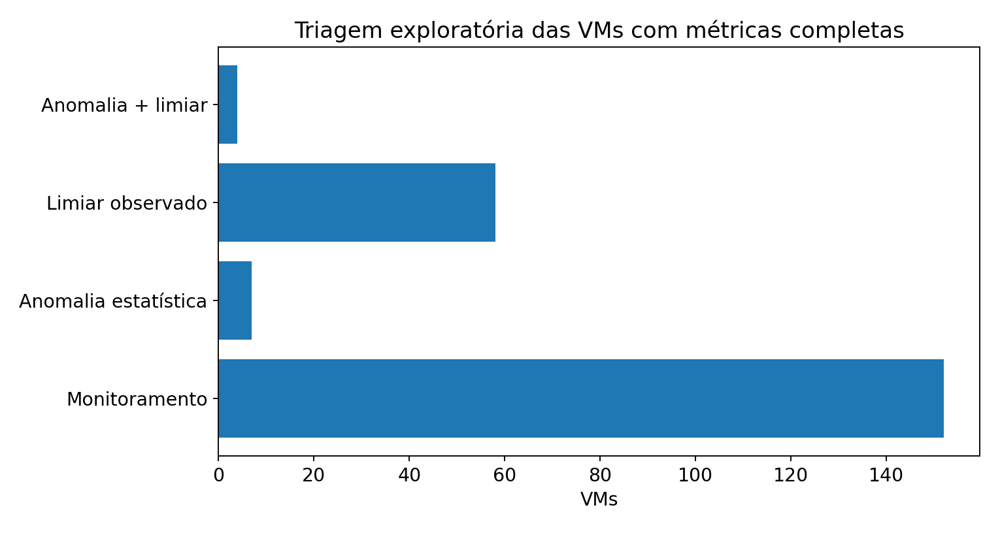
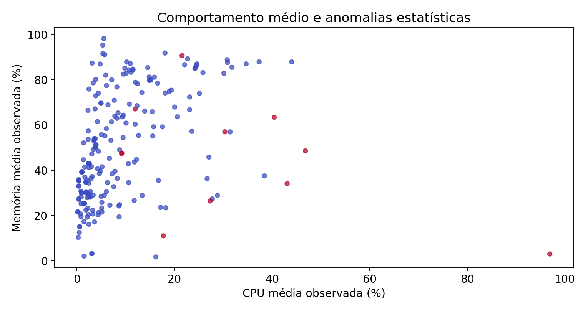

# 🌌 AIOps — Detecção de anomalias e priorização de investigação

   

> **RMC AI Labs · Predict. Optimize. Evolve.**

## 📚 Trilha de laboratórios
| Etapa | Conteúdo | Arquivo |
|---|---|---|
| 00 | PCA e K-Means no dataset Wine | [`Laboratorio_Wine_PCA_KMeans_tSNE.ipynb`](notebooks/Laboratorio_Wine_PCA_KMeans_tSNE.ipynb) |
| 01 | PCA, K-Means e t-SNE em perfis de VMs | [`Laboratorio_VM_Perfis_PCA_KMeans_tSNE.ipynb`](notebooks/Laboratorio_VM_Perfis_PCA_KMeans_tSNE.ipynb) |
| 02 | Isolation Forest, alertas e triagem | [`Laboratorio_AIOps_02_Anomalias_Triagem.ipynb`](notebooks/Laboratorio_AIOps_02_Anomalias_Triagem.ipynb) |

## 🔬 Base utilizada
- **253 VMs**, 12 hosts e 1 cluster VMware, com identificadores pseudonimizados.
- **21.199** observações de CPU, **21.199** de memória e **152.509** de disco.
- Apenas **221 VMs** apresentaram todos os atributos necessários para o modelo.
- O experimento retornou **11 anomalias estatísticas**, **62 VMs com limiar registrado** e **4** na intersecção.

> Contagens observadas nesta execução. Anomalia não comprova incidente. `contamination=0.05` é um parâmetro assumido. Não atribuir resultados a um processo produtivo ou a decisões automáticas.

## 🧪 Reprodução (Conda / Python 3.12)
Execute no clone do repositório, preservando o `pyproject.toml` existente:

```bash
conda activate aiops
python -m pip install .
python -m ipykernel install --user --name aiops --display-name "Python (AIOps)"
```

Coloque a base autorizada em `data/pseudonimizados/`. Execute o notebook com o kernel **Python (AIOps)**. Não versionar a pasta de dados ou os resultados detalhados sem análise de autorização.

## 📊 Resultado reproduzido





## 🧭 Como interpretar

**Perfil de uso** é diferente de **anomalia estatística**, que é diferente de **limiar operacional excedido**. O objetivo da etapa 02 é ordenar perguntas e preparar a investigação, nunca recomendar desligamento de VMs com base apenas no modelo.

## 🔐 Privacidade e publicação
Dados observados, nomes pseudonimizados: isso não representa anonimização irreversível. Metadados, datas, séries e relações também podem revelar a origem. Os CSVs reais pseudonimizados ficam fora do GitHub até autorização explícita.

## 🔗 Repositório
https://github.com/chykynho/aiops-capacity-lab
