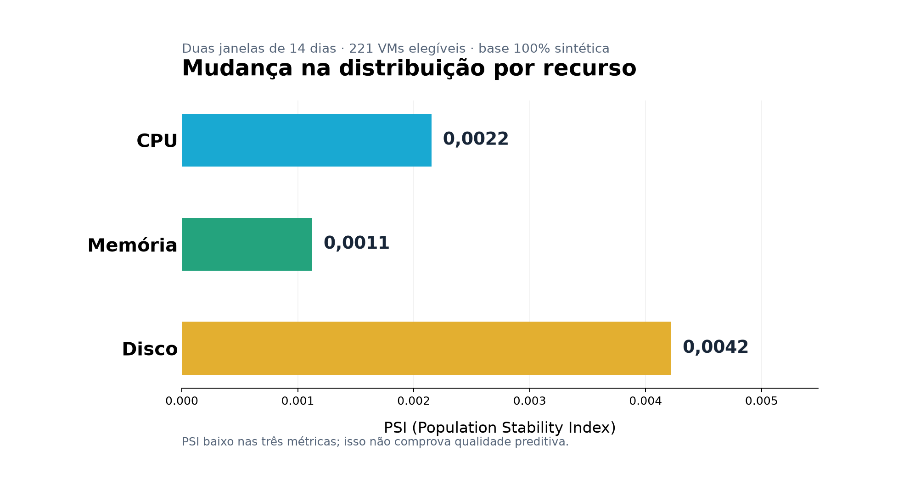
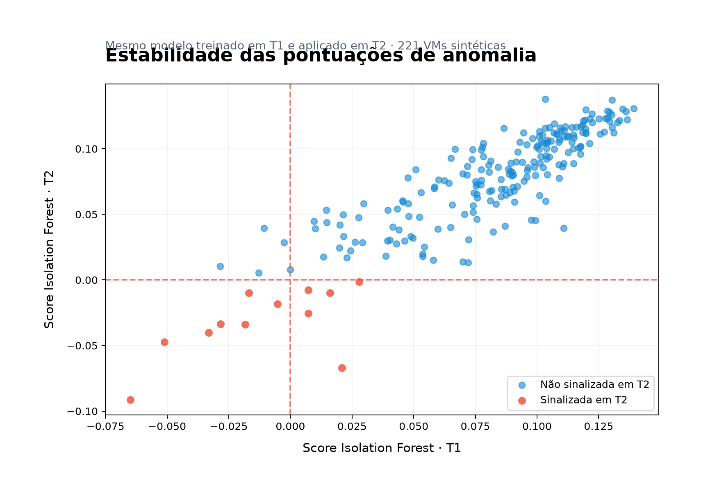

# 🤖 AIOps #05 — Data drift e estabilidade do detector

   

> **Pergunta do laboratório:** as distribuições das métricas mudaram? E o Isolation Forest treinado na janela anterior continua produzindo sinais semelhantes?

## 🧭 Trilha

| Laboratório | Tema |
|---|---|
| #01 | Perfis com PCA e K-Means |
| #02 | Anomalias com Isolation Forest |
| #03 | Priorização explicável |
| #04 | Mudança de medianas entre janelas |
| **#05** | **Distribuições, PSI/KS e estabilidade do detector** |

## 📂 Arquivos

| Arquivo | Uso |
|---|---|
| `notebooks/Laboratorio_AIOps_05_Data_Drift_Estabilidade.ipynb` | Aula e execução em Jupyter |
| `posts/aiops05/analisar.py` | Cálculos compartilhados pelo notebook e CLI |
| `posts/aiops05/resultados/*.png` | Gráficos efetivamente calculados |
| `posts/aiops05/resultados/*.csv` | Resultados derivados **somente dos dados sintéticos** |
| `data/public_demo/*.csv` | Fonte pública já existente; **não substituir ou duplicar** |

## ▶️ Executar no WSL2 / VS Code

```bash
cd ~/PythonProjects/aiops_capacity_lab
conda activate aiops
python -m pip install .
python posts/aiops05/analisar.py
```

Depois abra o notebook no VS Code, selecione o kernel `aiops` e execute todas as células.

## 📊 Resultados reproduzidos na preparação

- **253 VMs** no inventário público.
- **221 VMs** com dados completos de CPU, memória e disco nas duas janelas.
- **10 VMs** com mudança de mediana ≥ 8 pontos percentuais em pelo menos um recurso.
- **11** alertas do modelo na primeira janela e **12** na segunda; **7** VMs coincidentes.
- Jaccard entre conjuntos de alertas: **0.438**; correlação Spearman entre scores: **0.879**.

| Recurso | PSI | KS | p-valor KS |
|---|---:|---:|---:|
| cpu | 0.002 | 0.021 | 0.482 |
| memoria | 0.001 | 0.016 | 0.851 |
| disco | 0.004 | 0.034 | 0.0529 |

## 🖼️ Gráficos





## 🔎 O que significa o resultado?

**PSI** compara distribuições; **KS** é um teste estatístico entre as observações de duas janelas. Eles **não medem acurácia do Isolation Forest**, não demonstram `concept drift` e não autorizam retreinamento. Como há repetição temporal por VM, o p-valor KS deve ser interpretado como exploratório, não como inferência independente rigorosa.

O score do detector indica quão atípico um comportamento é segundo **o modelo congelado da janela T1**. A comparação das saídas ao longo do tempo permite levantar hipóteses de mudança, mas não confirmar falha do modelo. Antes de agir, validar completude, periodicidade da coleta, sazonalidade e composição da carga.

**Privacidade:** a execução pública usa exclusivamente `data/public_demo/`, que contém métricas inventadas; nunca publicar `data/pseudonimizados/`, identificadores de origem, nem o guia didático particular.


## 📣 Carrossel da publicação

O PDF `RMC_AIOps_05_LinkedIn.pdf` foi gerado **diretamente dos seis PNGs** em `carrossel/` (1080 × 1350), uma página por imagem.

Os resultados do laboratório são: **PSI CPU 0,002153; memória 0,001124; disco 0,004221**. Não use os valores ilustrativos de artes anteriores.

Na comparação de alertas: **4 exclusivos de T1, 7 persistentes, 5 exclusivos de T2**; total de 11 em T1 e 12 em T2. São conjuntos de alertas, não incidentes comprovados.

As artes e legendas são materiais editoriais. Publique somente arquivos técnicos revisados no repositório.
